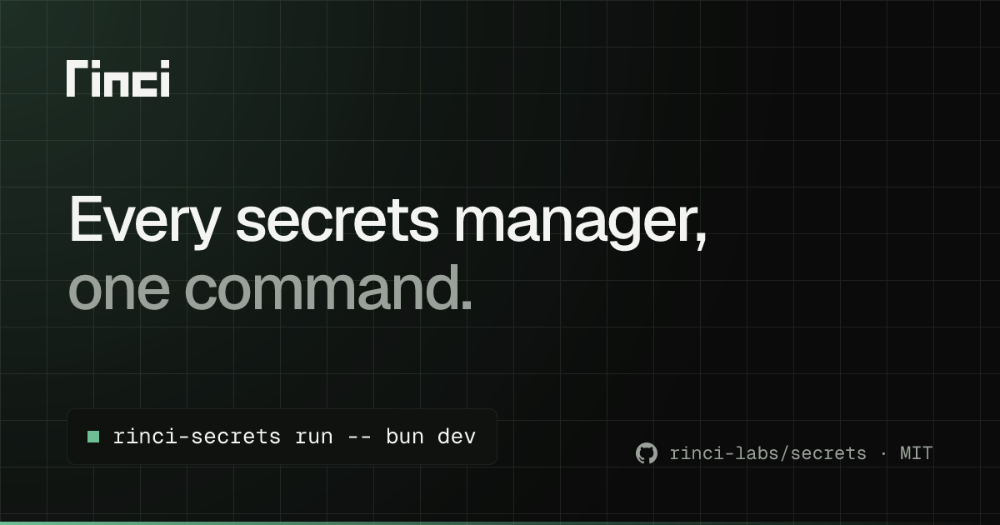
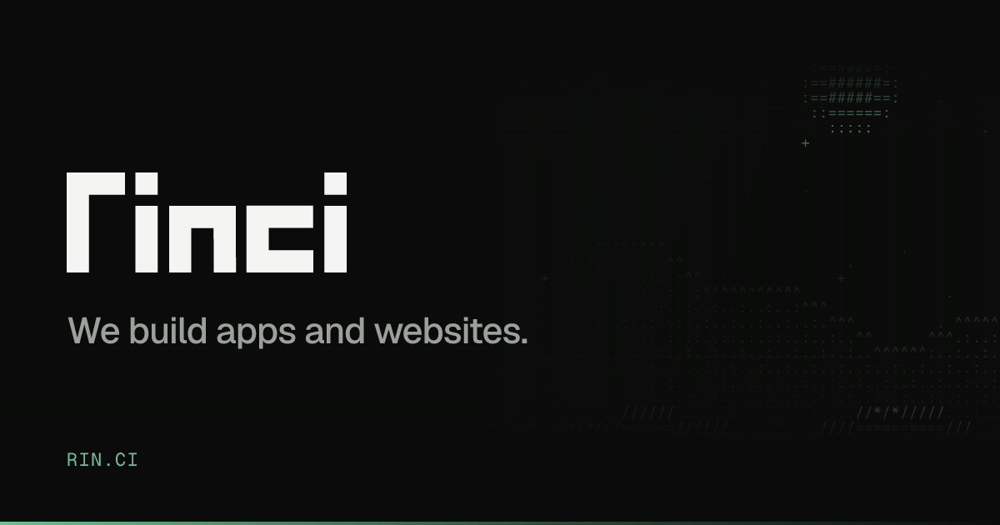
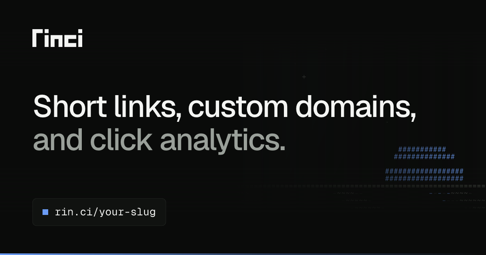
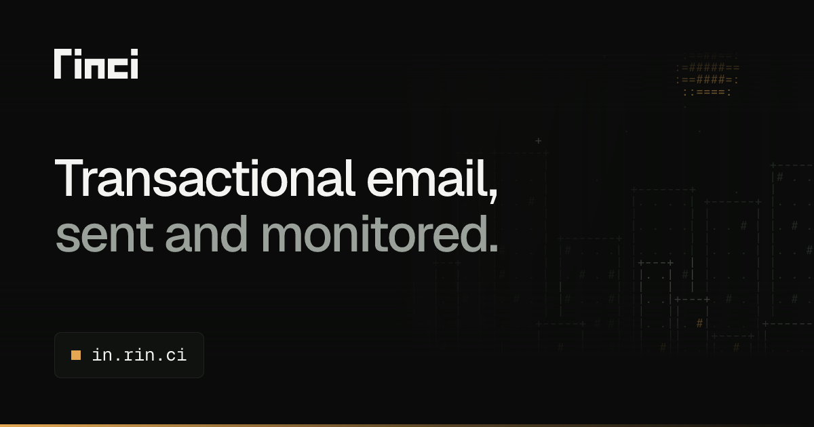
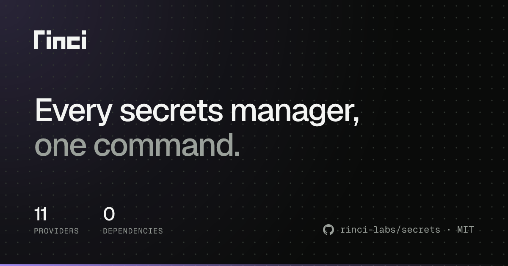

# @rinci/og

Open Graph cards for RINCI sites. Every card shares the brand's ink, Geist type, signal accent and wordmark, so a link to any RINCI product looks like it came from the same place. Output is a 1200×630 PNG.



The layout started as the card on secrets.rin.ci and moved here so link.rin.ci and the rest match it.

## Install

```sh
bun add -d @rinci/og
```

## Use it in code

```ts
import { renderCard } from "@rinci/og"

const png = await renderCard({
  title: "Short links, custom domains,",
  subtitle: "and click analytics.",
  chip: "rin.ci/your-slug",
})
```

In Astro, render it from an endpoint at build time:

```ts
// src/pages/og.png.ts
import { renderCard } from "@rinci/og"

export const GET = async () =>
  new Response(
    await renderCard({
      title: "Every secrets manager,",
      subtitle: "one command.",
      chip: "rinci-secrets run -- bun dev",
    }),
    {
      headers: { "Content-Type": "image/png" },
    },
  )
```

`renderCardSvg` returns the SVG instead of the PNG.

## Use it from the terminal

```sh
bunx rinci-og --title "Short links, custom domains," --subtitle "and click analytics." --chip "rin.ci/your-slug" --background dots --out public/og.png
bunx rinci-og --title "Every secrets manager," --subtitle "one command." --stat 11:providers --stat 0:dependencies --repo rinci-labs/secrets --license MIT
bunx rinci-og --variant mark --tagline "We build apps and websites." --url rin.ci --background mountains
bunx rinci-og --title "Transactional email," --subtitle "sent and monitored." --chip in.rin.ci --background city --accent amber
```

`rinci-og --help` lists every flag.

## Variants

**Headline** (the default) is for home pages and docs: a two-line headline, a footer, and an optional label top right.

**Mark** is the wordmark on its own with one line under it, for the company site, fallbacks and error pages.

```ts
renderCard({ variant: "mark", tagline: "We build apps and websites.", url: "rin.ci" })
```



## Backgrounds

Pass `background` to either variant. Give each product its own so the cards tell apart at a glance.

| `background`     | Looks like                                                      |
| ---------------- | --------------------------------------------------------------- |
| `grid` (default) | The 56px brand grid                                             |
| `dots`           | A 28px dot grid                                                 |
| `plain`          | Ink and the corner glow only                                    |
| `matrix`         | Columns of the brand's ASCII glyphs falling down the right side |
| `mountains`      | Two ridgelines under a moon and stars, in ASCII                 |
| `waves`          | A banded sun setting over the sea, in ASCII                     |
| `city`           | A skyline with lit windows, in ASCII                            |

The ASCII backgrounds are seeded by the card's text, so the same card renders the same image on every build. They fade out before the headline and the footer, and anything drawn behind the headline drops to the faintest tone, so the art never competes with the text.





## Accents

`accent` takes a preset or any hex colour. It colours the corner glow, the bottom bar, the chip marker and the highlights in the ASCII art. The default is `signal`, the brand green.

| Preset   | Hex       |
| -------- | --------- |
| `signal` | `#6fbf95` |
| `blue`   | `#6b9cf5` |
| `amber`  | `#e4a853` |
| `rose`   | `#e8798d` |
| `violet` | `#a48af0` |
| `cyan`   | `#5cc8d6` |

```ts
renderCard({
  background: "waves",
  accent: "blue",
  title: "Short links, custom domains,",
  subtitle: "and click analytics.",
  chip: "rin.ci/your-slug",
})
```



## Headline props

| Prop       | Required               | Notes                                                                                                |
| ---------- | ---------------------- | ---------------------------------------------------------------------------------------------------- |
| `title`    | yes                    | First line, in paper. Over 30 characters the headline drops from 76px to 64px.                       |
| `subtitle` | yes                    | Second line, in dim. Up to 44 characters it continues the headline; longer text becomes a paragraph. |
| `chip`     | one of `chip`, `stats` | Monospace text in the chip, such as a command or a URL.                                              |
| `stats`    | one of `chip`, `stats` | Up to three `{ value, label }` figures, shown in place of the chip.                                  |
| `label`    | no                     | Small uppercase label top right, such as `Docs · Providers`.                                         |
| `repo`     | no                     | GitHub `owner/name`, shown bottom right with the GitHub mark. Use it for open source projects.       |
| `license`  | no                     | Shown after the repo, such as `MIT`.                                                                 |

Text that would not fit is cut at a word boundary with an ellipsis. With a repo in the footer, the chip and stat labels get shorter so they never run into it.

## Develop

```sh
bun install
bun test
bun run examples   # writes examples/*.png
```

Geist and Geist Mono are vendored as TTF in `fonts/` because Satori cannot read the woff2 files in `@rinci/brand`. They are under the SIL Open Font License (`fonts/OFL.txt`).
